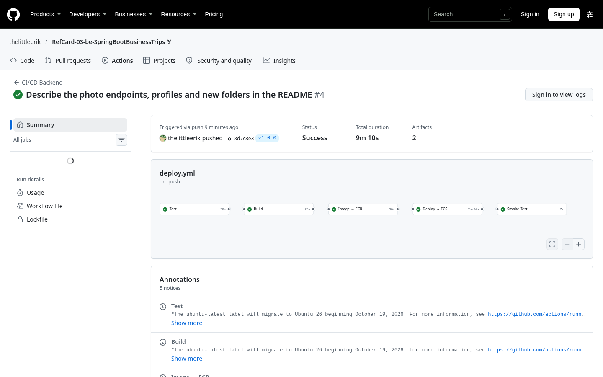
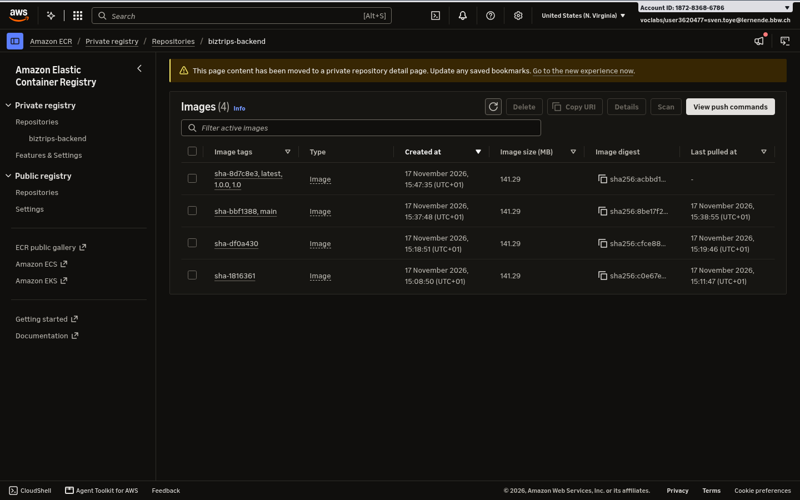
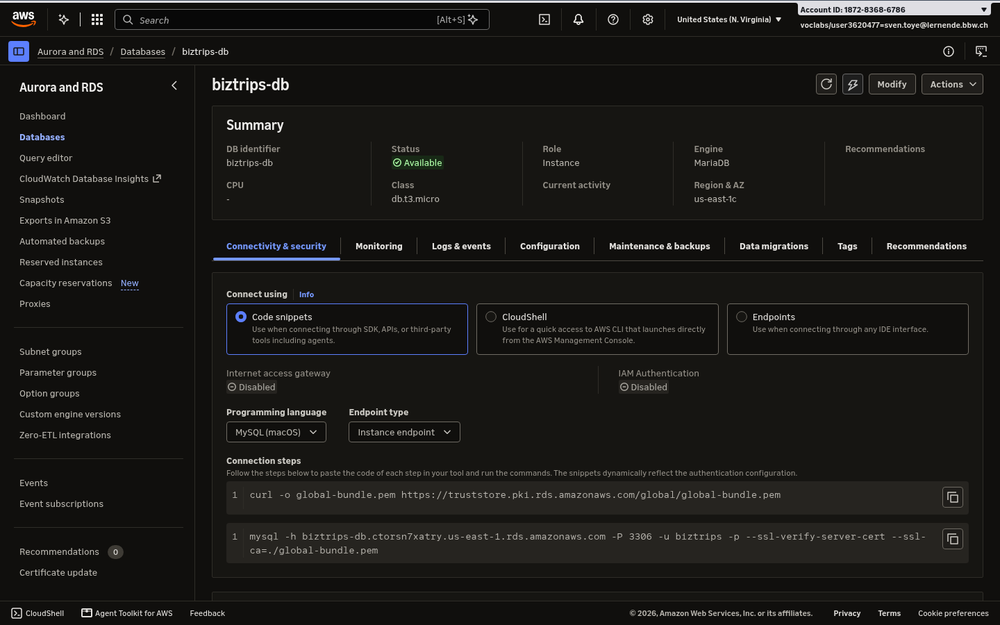
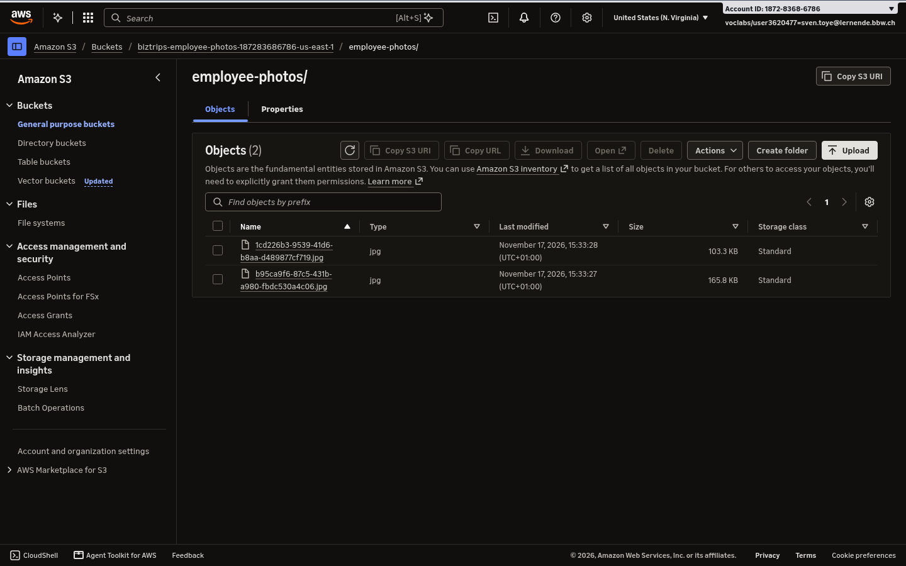
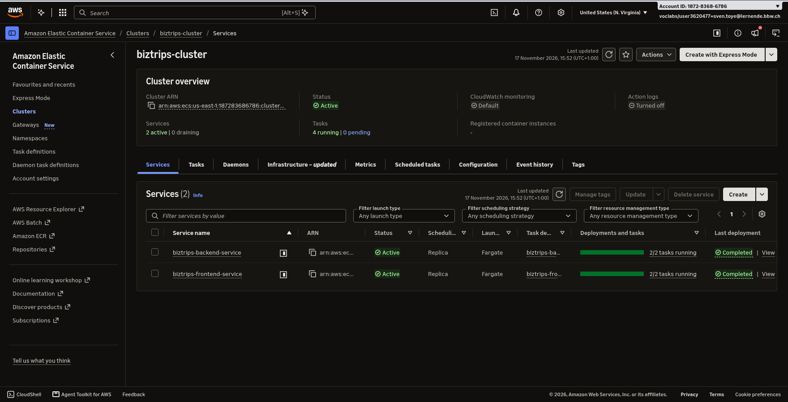
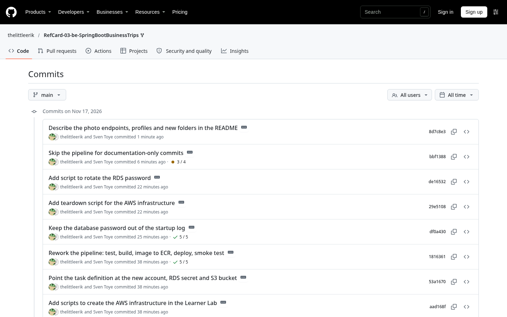
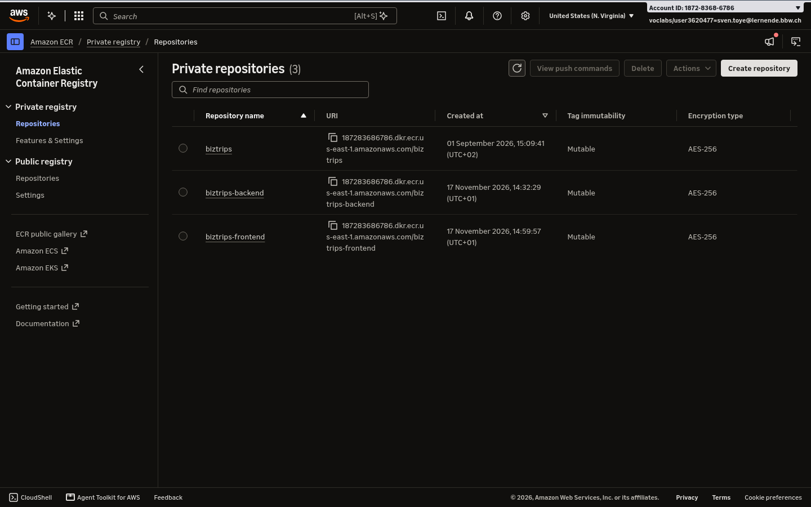

# RefCard 05 – Full-Stack auf AWS (ECR, ECS, RDS, S3)

Abgabe von **Erik Oros** und **Sven Toye** (Partnerarbeit). Die Repos liegen unter dem GitHub-Konto
`thelittleerik`, die AWS-Ressourcen im Learner-Lab-Account von Sven Toye (`187283686786`, `us-east-1`).
Jeder Commit nennt beide als Autoren.

| Repo | Inhalt |
| --- | --- |
| [RefCard-03-be-SpringBootBusinessTrips](https://github.com/thelittleerik/RefCard-03-be-SpringBootBusinessTrips) | Backend, gemeinsame AWS-Infrastruktur, diese Dokumentation |
| [refcard-03-fe-react-vite](https://github.com/thelittleerik/refcard-03-fe-react-vite) | Frontend ([eigene Doku](https://github.com/thelittleerik/refcard-03-fe-react-vite/blob/main/docs/RefCard05.md)) |
| [refcard-05-compose](https://github.com/thelittleerik/refcard-05-compose) | Docker Compose für die lokale Entwicklung |

Applikation: <http://biztrips-alb-813624757.us-east-1.elb.amazonaws.com> (nur solange die Lab-Session läuft).

## 1. Architektur

```
                         Internet
                            │ HTTP :80
                ┌───────────▼────────────┐
                │ Application Load       │  biztrips-alb
                │ Balancer               │
                └──────┬───────────┬─────┘
       /v1/*, /actuator/*          │ alles andere
                ┌──────▼─────┐ ┌───▼────────┐
                │ Backend    │ │ Frontend   │   ECS-Cluster biztrips-cluster (Fargate)
                │ 2 Tasks    │ │ 2 Tasks    │   zwei unabhängige Services
                │ Spring Boot│ │ nginx      │
                └──┬──────┬──┘ └────────────┘
          :3306    │      │ HTTPS
        ┌──────────▼┐   ┌─▼──────────────────┐
        │ RDS       │   │ S3-Bucket          │
        │ MariaDB   │   │ employee-photos/   │
        └───────────┘   └────────────────────┘
```

Frontend und Backend teilen sich einen Load Balancer. Dadurch liegen beide auf derselben Adresse: es
braucht kein CORS und nur einen Load Balancer. Jeder Service hat sein eigenes Repo, sein eigenes
ECR-Repository, seine eigene Pipeline und wird unabhängig vom anderen deployt.

| Ressource | Name | Angelegt von |
| --- | --- | --- |
| ECS-Cluster | `biztrips-cluster` | `infra/setup-aws.sh` (dieses Repo) |
| Load Balancer, Security Groups | `biztrips-alb`, `biztrips-{alb,frontend,backend,db}-sg` | dieses Repo |
| RDS-Instanz, Secret | `biztrips-db`, `biztrips/backend/db` | dieses Repo |
| S3-Bucket | `biztrips-employee-photos-187283686786-us-east-1` | dieses Repo |
| ECR, Service, Target Group Backend | `biztrips-backend`, `biztrips-backend-service`, `biztrips-backend-tg` | dieses Repo |
| ECR, Service, Target Group Frontend | `biztrips-frontend`, `biztrips-frontend-service`, `biztrips-frontend-tg` | `infra/setup-aws.sh` im Frontend-Repo |

Die gesamte Infrastruktur wird per Skript angelegt (`infra/setup-aws.sh`, mehrfach ausführbar) und mit
`infra/teardown-aws.sh` wieder gelöscht.

## 2. Pipeline (Aufgabe 1)

[`.github/workflows/deploy.yml`](../.github/workflows/deploy.yml) – fünf Jobs, jeder baut auf dem vorherigen auf:

| Job | Was passiert |
| --- | --- |
| **Test** | `./mvnw test` (21 Tests, H2). Bei Fehlern werden die Testberichte als Artefakt angehängt. |
| **Build** | Jar bauen und als Artefakt ablegen. |
| **Image → ECR** | Version bestimmen, Multi-Stage-Image bauen (Maven-Build → JRE-Alpine), nach ECR pushen. |
| **Deploy → ECS** | Task-Definition mit dem neuen Image registrieren, Rolling Deployment, warten bis stabil. |
| **Smoke-Test** | Den ausgelieferten Stand von aussen prüfen ([`scripts/smoke-test.sh`](../scripts/smoke-test.sh)). |

Pull Requests laufen nur bis **Build**. Reine Dokumentations-Commits lösen keine Pipeline aus.

Was die Pipeline robust macht:

- **Caching:** Maven-Abhängigkeiten (`setup-java`) und Docker-Layer (`cache-from/to: type=gha`).
- **Verständliche Fehlermeldungen:** fehlende oder abgelaufene Lab-Zugangsdaten, ein ungültiger
  Release-Tag oder ein fehlender ECS-Service brechen mit einer Meldung ab, die sagt, was zu tun ist.
  Schlägt ein Deployment fehl, gibt die Pipeline die letzten Service-Events und die Stop-Gründe der Tasks aus.
- **Deployments überholen sich nicht:** pro Service läuft immer nur ein Deployment (`concurrency`).



## 3. Versionierung (Aufgabe 1)

Beide Repos verwenden dasselbe Schema. Der Git-Tag bestimmt den Image-Tag in ECR:

| Auslöser | Image-Tags in ECR | Beispiel |
| --- | --- | --- |
| Push auf `main` | `sha-<commit>`, `main` | `sha-bbf1388`, `main` |
| Git-Tag `vMAJOR.MINOR.PATCH` | `MAJOR.MINOR.PATCH`, `MAJOR.MINOR`, `latest`, `sha-<commit>` | `v1.0.0` → `1.0.0`, `1.0`, `latest` |

- Ein Tag, der nicht dem Muster `vX.Y.Z` entspricht oder nicht auf einem Commit von `main` liegt, wird abgelehnt.
- Deployt wird immer ein eindeutiger Tag (`1.0.0` bzw. `sha-…`), nie `latest`. So ist in ECS ablesbar,
  welche Version läuft, und ein Rollback ist eine ältere Task-Definition.
- Die laufende Version ist von aussen abfragbar: `/actuator/info` (Backend), `/version.json` (Frontend).
- ECR räumt selbst auf: nur die letzten 15 `sha-`Images bleiben, Release-Tags werden nie gelöscht
  ([`infra/ecr-lifecycle-policy.json`](../infra/ecr-lifecycle-policy.json)).

Ein Release erstellen:

```bash
git tag -a v1.1.0 -m "Release 1.1.0: <was ist neu>"
git push origin v1.1.0
```

| Repo | Release | Image | Commit |
| --- | --- | --- | --- |
| Backend | [`v1.0.0`](https://github.com/thelittleerik/RefCard-03-be-SpringBootBusinessTrips/releases/tag/v1.0.0) | `biztrips-backend:1.0.0` | `8d7c8e3` |
| Frontend | [`v1.0.0`](https://github.com/thelittleerik/refcard-03-fe-react-vite/releases/tag/v1.0.0) | `biztrips-frontend:1.0.0` | `b7c2f67` |



## 4. RDS / MariaDB (Aufgabe 2)

- Instanz `biztrips-db`: MariaDB 10.11, `db.t3.micro`, verschlüsselt, **nicht öffentlich erreichbar**.
- Die Security Group der Datenbank lässt Port 3306 ausschliesslich von der Security Group der Backend-Tasks zu.
- Das Passwort erzeugt `setup-aws.sh` zufällig und schreibt es direkt nach **AWS Secrets Manager**
  (`biztrips/backend/db`). Es steht in keinem Repo, in keiner Task-Definition und in keinem GitHub Secret.

Konfiguration im Backend – getrennt über Spring-Profile:

| Profil | Datei | Datenbank |
| --- | --- | --- |
| *(Default)* | `application.properties` | H2 im Speicher (Tests) |
| `mariadb` | `application-mariadb.properties` | lokaler MariaDB-Container der Vorlage |
| `aws` | [`application-aws.properties`](../src/main/resources/application-aws.properties) | RDS, ausschliesslich über Umgebungsvariablen |

Das Profil `aws` hat keine Defaults für Host, Benutzer oder Passwort. Fehlt eine Variable, startet die
Applikation nicht. Auf ECS kommen alle fünf Werte aus dem Secret
([`task-definition.json`](../task-definition.json), Abschnitt `secrets`):

```
DB_HOST, DB_PORT, DB_NAME, DB_USERNAME, DB_PASSWORD  ←  Secrets Manager biztrips/backend/db
```

Nachweis der Verbindung: `/actuator/health` meldet nur `UP`, wenn die Datenbank antwortet – der Load
Balancer und der Container-Health-Check fragen genau diesen Pfad ab. Zusätzlich liest der Smoke-Test nach
jedem Deployment die Trips aus der Datenbank.

**Aufgefallen und behoben:** Beim ersten Deployment stand das Datenbank-Passwort im Klartext in CloudWatch.
Hibernate gibt beim Start die JDBC-URL aus, und der MariaDB-Treiber hängt Benutzer und Passwort an. Der
Logger ist jetzt auf `WARN` gesetzt (`application.properties`), und das Passwort wurde danach mit
[`infra/rotate-db-password.sh`](../infra/rotate-db-password.sh) ersetzt. Das alte Passwort ist ungültig.



## 5. S3 und IAM Least Privilege (Aufgabe 2)

Der Storage-Endpoint aus RefCard 04 (`/v1/employees/{id}/photo`, Upload/Download/Löschen) liegt hinter dem
Interface `StorageService` mit zwei Implementierungen:

| Implementierung | Aktiv bei | Ablage |
| --- | --- | --- |
| `LocalStorageService` | `app.storage.type=local` (Default) | Verzeichnis bzw. Volume (RefCard 04) |
| `S3StorageService` | `app.storage.type=s3` (Profil `aws`) | S3-Bucket, Präfix `employee-photos/` |

In der Datenbank steht nur der Dateiname. Dateien werden geprüft (PNG/JPEG/WebP, max. 5 MB) und unter
einer UUID abgelegt. Zugangsdaten für S3 gibt es im Code keine: das SDK bezieht sie auf ECS von der Task-Rolle.

### Least Privilege im Learner Lab

Die Aufgabe verlangt eine eigene IAM-Rolle nur für den Bucket. Im Learner Lab ist das nicht möglich:

| Aktion | Ergebnis im Learner Lab |
| --- | --- |
| `iam:CreateRole` | verweigert |
| `iam:AttachRolePolicy` / `iam:PutRolePolicy` auf `LabRole` | verweigert |
| `iam:CreatePolicy` | erlaubt |

Der Task muss deshalb die vorgegebene `LabRole` verwenden, und diese hat sehr weite Rechte. Die
Einschränkung auf den Bucket setzen wir darum **am Bucket** durch, mit einer Bucket-Policy
([`infra/s3-bucket-policy.json`](../infra/s3-bucket-policy.json)). Ein explizites `Deny` in einer
Bucket-Policy gilt auch dann, wenn die Rolle selbst mehr erlauben würde:

| Statement | Wirkung |
| --- | --- |
| `AllowBackendTaskRoleObjectAccess` | `LabRole` darf `GetObject`, `PutObject`, `DeleteObject` – nur unter `employee-photos/` |
| `DenyTaskRoleOtherActions` | `LabRole` darf im Bucket nichts anderes (kein Auflisten, kein Ändern der Policy, kein Löschen des Buckets) |
| `DenyTaskRoleOutsidePrefix` | `LabRole` darf keine Objekte ausserhalb von `employee-photos/` lesen oder schreiben |
| `DenyEveryOtherPrincipal` | alle anderen Identitäten sind ausgesperrt (ausser der Lab-Benutzerrolle zur Verwaltung) |
| `DenyInsecureTransport` | Zugriff nur über HTTPS |

Zusätzlich ist der öffentliche Zugriff blockiert und der Bucket verschlüsselt (SSE-S3).

Geprüft mit dem IAM-Policy-Simulator (`LabRole` + Bucket-Policy):

| Zugriff der Task-Rolle | Ergebnis |
| --- | --- |
| `GetObject` / `PutObject` / `DeleteObject` auf `employee-photos/test.png` | `allowed` |
| dieselben Aktionen auf `other/test.png` | `explicitDeny` |
| `ListBucket`, `DeleteBucket`, `PutBucketPolicy` auf den Bucket | `explicitDeny` |

**Grenze dieser Lösung:** Die Policy schützt *diesen Bucket*. Auf andere AWS-Dienste hat die `LabRole`
weiterhin ihre weiten Rechte – das lässt sich im Learner Lab nicht ändern.

**So wäre es in einem produktiven Account:** eine eigene Task-Rolle, die nur von `ecs-tasks.amazonaws.com`
angenommen werden kann, mit genau einer Policy. Diese Policy liegt als
[`infra/iam-policy-s3-least-privilege.json`](../infra/iam-policy-s3-least-privilege.json) im Repo und ist
im Account als `biztrips-backend-s3-least-privilege` angelegt – sie kann im Lab nur nicht an eine Rolle
gehängt werden.

### Fehlerfälle

| Fall | Verhalten |
| --- | --- |
| Task hat keine Rechte auf den Bucket | Upload antwortet mit `502` und einer Meldung statt mit einem Stacktrace; Ursache steht im Log |
| Bucket nicht erreichbar | `503` |
| Rechte fehlen schon beim Start | Das Backend macht beim Start einen Schreibtest und meldet einen Fehler im Log, bevor jemand ein Foto hochlädt |
| Falscher Dateityp, leere oder zu grosse Datei | `400` bzw. `413`, S3 wird nicht aufgerufen |
| Upload scheitert | Der Mitarbeiter-Datensatz bleibt unverändert |

Diese Fälle sind durch Tests abgedeckt (`S3StorageServiceTest`, `EmployeePhotoStorageFailureTest`).



## 6. ECS-Deployment (Aufgabe 3)

| | Backend | Frontend |
| --- | --- | --- |
| Service | `biztrips-backend-service` | `biztrips-frontend-service` |
| Tasks | 2 | 2 |
| CPU / Speicher | 0.5 vCPU / 1 GB | 0.25 vCPU / 0.5 GB |
| Container-Health-Check | `/actuator/health` | `/healthz` |
| Health-Check des Load Balancers | `/actuator/health` | `/healthz` |
| Erreichbar | nur vom Load Balancer (Security Group) | nur vom Load Balancer (Security Group) |

- **Rolling Deployment ohne Unterbruch:** neue Tasks starten zuerst, alte werden erst entfernt, wenn die
  neuen gesund sind (`minimumHealthyPercent=100`).
- **Automatisches Rollback:** Werden neue Tasks nicht gesund, bricht ECS das Deployment ab und behält die
  alte Version (Deployment Circuit Breaker).
- Der Container läuft nicht als `root`; die JVM nutzt höchstens 75 % des Task-Speichers.



## 7. Automatisches Redeploy (Aufgabe 3)

Jedes neue Image führt in beiden Repos ohne Handarbeit zu neuen Tasks: Der Job **Deploy → ECS** registriert
eine neue Task-Definition mit genau dem Image, das der Job davor gepusht hat, und wartet, bis der Service stabil ist.

Danach prüft der Job **Smoke-Test** von aussen über den Load Balancer:

1. `/actuator/health` meldet `UP`.
2. `/actuator/info` nennt **den Commit, der gerade deployt wurde**. Hat ECS zurückgerollt, läuft noch der
   alte Stand – dann schlägt dieser Schritt fehl, obwohl der Service „stabil“ ist.
3. `/v1/trips` liefert Daten aus der Datenbank.
4. Ein Foto wird hochgeladen, wieder geladen, verglichen und gelöscht (S3).

## 8. Learner-Lab-Zugangsdaten (Aufgabe 3)

In beiden Repos sind genau drei GitHub Secrets hinterlegt: `AWS_ACCESS_KEY_ID`, `AWS_SECRET_ACCESS_KEY`,
`AWS_SESSION_TOKEN`. Die Pipeline verwendet sie in `aws-actions/configure-aws-credentials`. Im Code, in den
Task-Definitionen und in den Skripten stehen keine Zugangsdaten.

```
$ gh secret list
AWS_ACCESS_KEY_ID       2026-11-17
AWS_SECRET_ACCESS_KEY   2026-11-17
AWS_SESSION_TOKEN       2026-11-17
```

### Wenn die Lab-Session abläuft

Die Zugangsdaten gelten nur für eine Lab-Session (rund vier Stunden). Danach schlägt die Pipeline im
Schritt „Bei AWS anmelden“ mit der Meldung *Learner-Lab-Session abgelaufen* fehl. Vorgehen:

1. Lab neu starten (**Start Lab**), **AWS Details → AWS CLI** öffnen.
2. Den angezeigten Block nach `~/.aws/credentials` kopieren.
3. Secrets in beiden Repos erneuern:
   ```bash
   ./scripts/refresh-lab-secrets.sh thelittleerik/RefCard-03-be-SpringBootBusinessTrips thelittleerik/refcard-03-fe-react-vite
   ```
4. Den fehlgeschlagenen Workflow-Lauf erneut starten (**Re-run jobs**).

Das Skript prüft zuerst, ob die lokalen Zugangsdaten gültig sind, und gibt die Werte nie aus. Die Tasks
selbst verwenden die Task-Rolle und nicht diese Zugangsdaten; betroffen ist nur die Pipeline.

### Vergleich mit OIDC

| | Learner Lab (diese Lösung) | OIDC (produktiver Account) |
| --- | --- | --- |
| Was liegt in GitHub | drei Zugangsdaten als Secrets | nichts Geheimes, nur der Name der Rolle |
| Gültigkeit | eine Lab-Session, von Hand zu erneuern | pro Workflow-Lauf neu ausgestellt, wenige Minuten gültig |
| Rechte | alles, was die Lab-Benutzerrolle darf | eine eigene Rolle nur für dieses Repo und diesen Branch |
| Risiko bei einem Leck | Zugriff auf den Account bis zum Ende der Session | kein verwertbares Geheimnis vorhanden |

OIDC (wie in EX-03 gezeigt) ist der richtige Weg, sobald der Account es zulässt. Im Learner Lab scheitert
es an `iam:CreateOpenIDConnectProvider` und `iam:CreateRole`.

## 9. Lokale Entwicklung (Aufgabe 4)

Eigenes Repo: [refcard-05-compose](https://github.com/thelittleerik/refcard-05-compose). Es startet
Frontend, Backend, MariaDB und MinIO (S3-kompatibel) mit einem Befehl; die Reihenfolge ist über
Healthchecks festgelegt. Das Backend läuft lokal mit demselben Profil und demselben S3-Code wie auf AWS.

```bash
cp .env.example .env
docker compose up --build --wait
```

## 10. Nachweise

| Nachweis | Wo |
| --- | --- |
| Commits (beide Autoren) | [Backend](https://github.com/thelittleerik/RefCard-03-be-SpringBootBusinessTrips/commits/main/), [Frontend](https://github.com/thelittleerik/refcard-03-fe-react-vite/commits/main/), [Compose](https://github.com/thelittleerik/refcard-05-compose/commits/main/) |
| Workflow-Läufe | [Backend](https://github.com/thelittleerik/RefCard-03-be-SpringBootBusinessTrips/actions), [Frontend](https://github.com/thelittleerik/refcard-03-fe-react-vite/actions) |
| ECR, ECS, S3, RDS | Screenshots in diesem Dokument |
| Laufende Applikation | Screenshot in der [Frontend-Doku](https://github.com/thelittleerik/refcard-03-fe-react-vite/blob/main/docs/RefCard05.md) |





## 11. Aufräumen

Die Ressourcen verbrauchen Lab-Guthaben, solange sie laufen. Nach der Bewertung:

```bash
# 1. im Frontend-Repo
./infra/teardown-aws.sh
# 2. in diesem Repo
./infra/teardown-aws.sh
```

Beide Skripte zeigen an, was gelöscht wird, und verlangen die Account-ID als Bestätigung.
